<!-- The cards are rendered by scripts/render_cards.py and refreshed daily by .github/workflows/cards.yml.
     Preview the final frame locally: STATIC=1 python scripts/render_cards.py, then open preview/index.html -->
